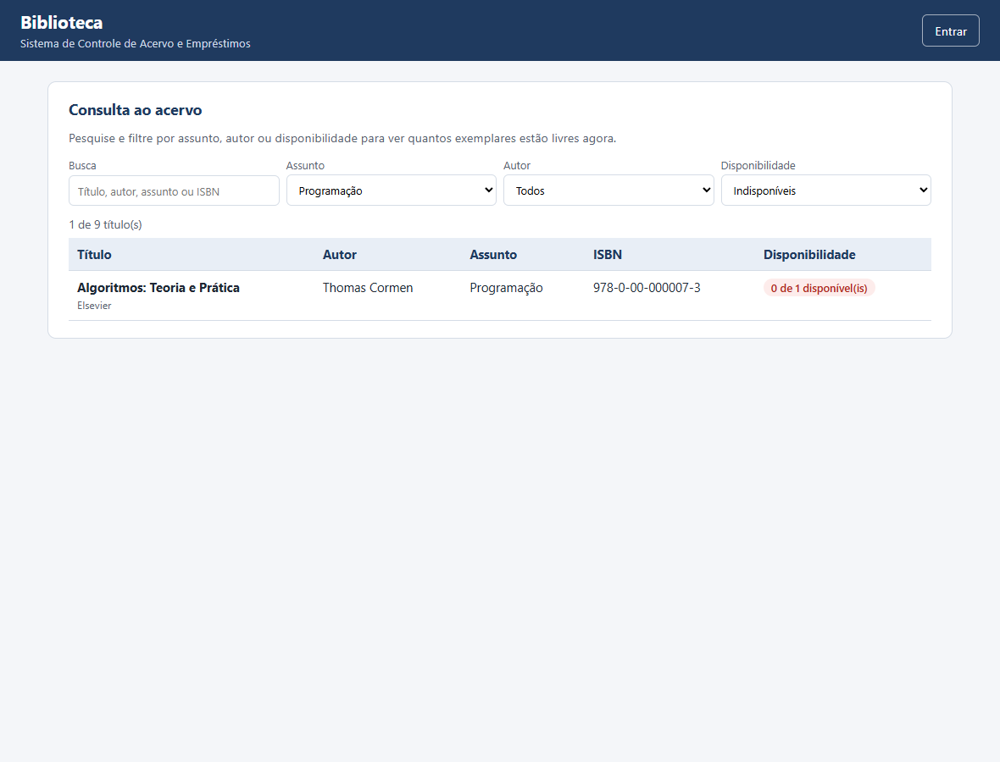
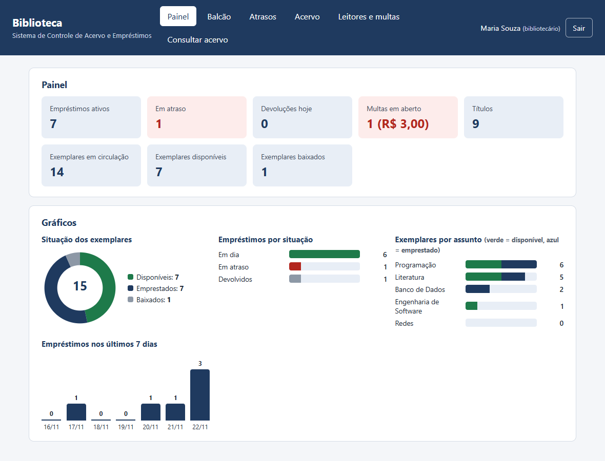
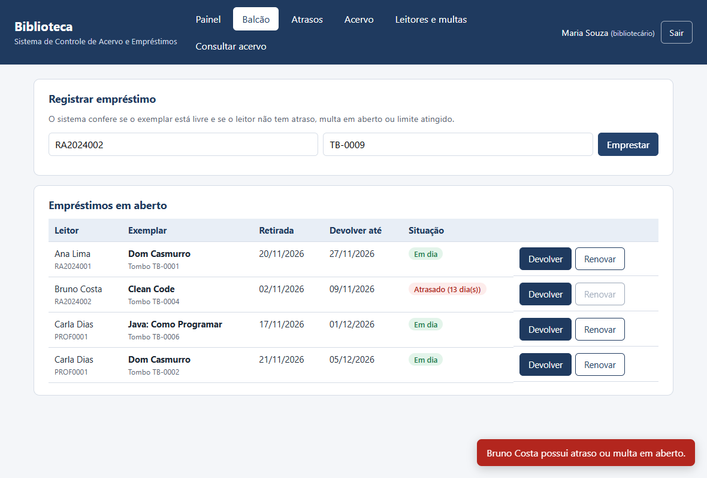
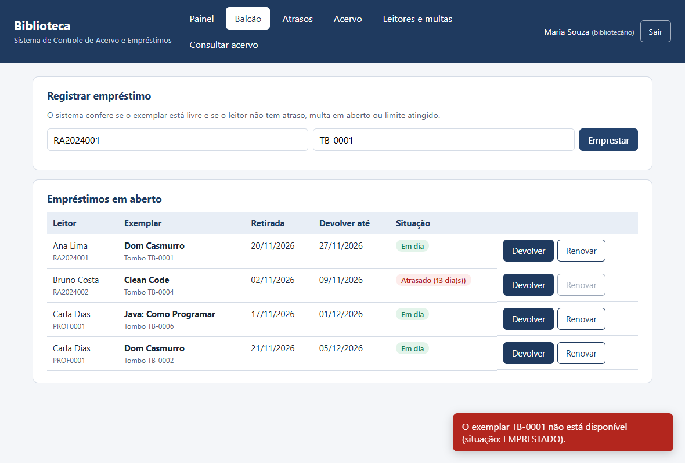
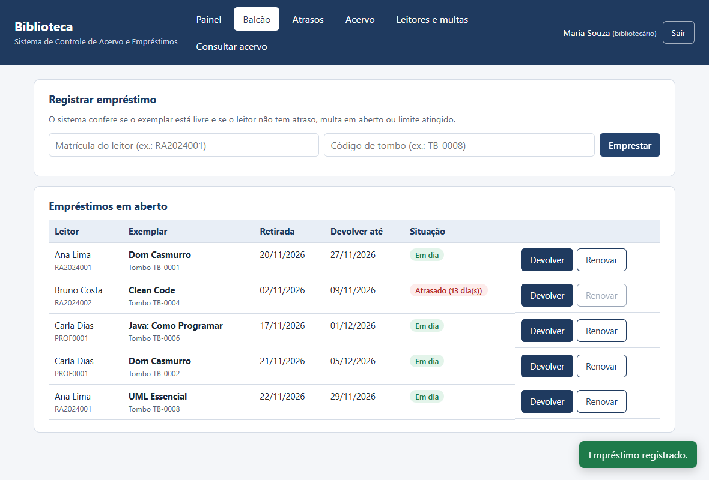
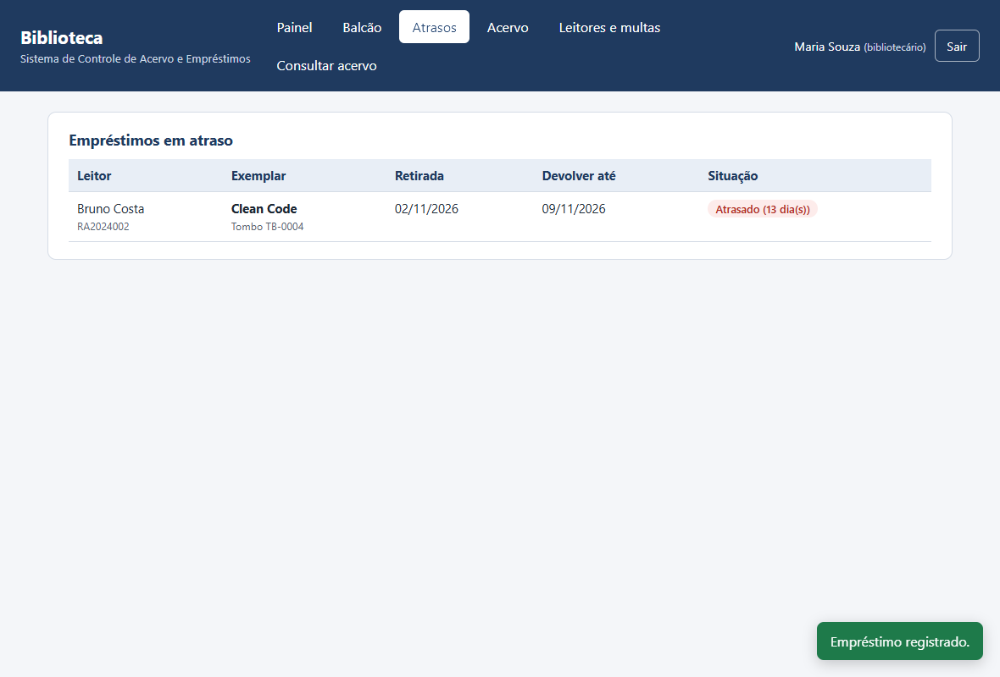
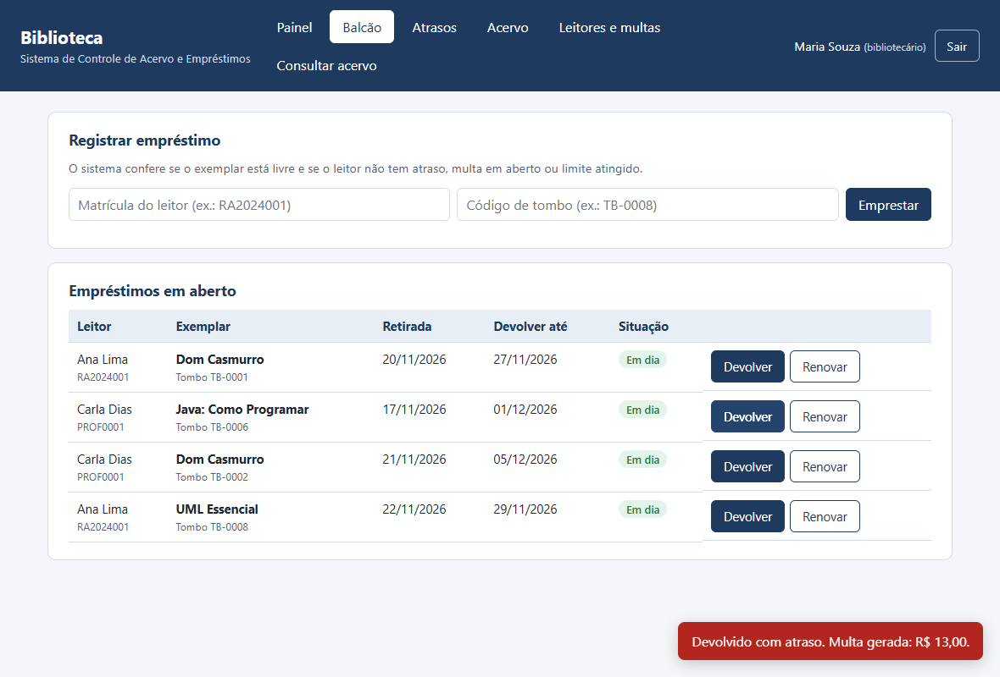
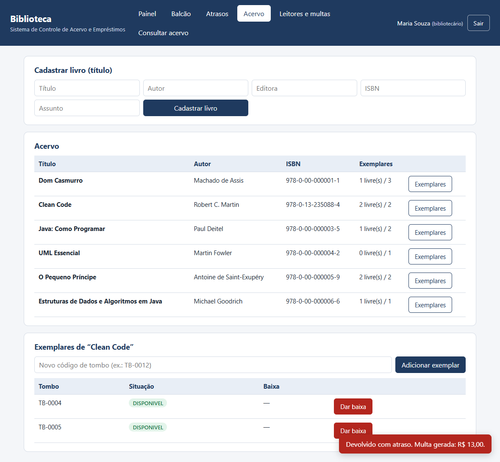
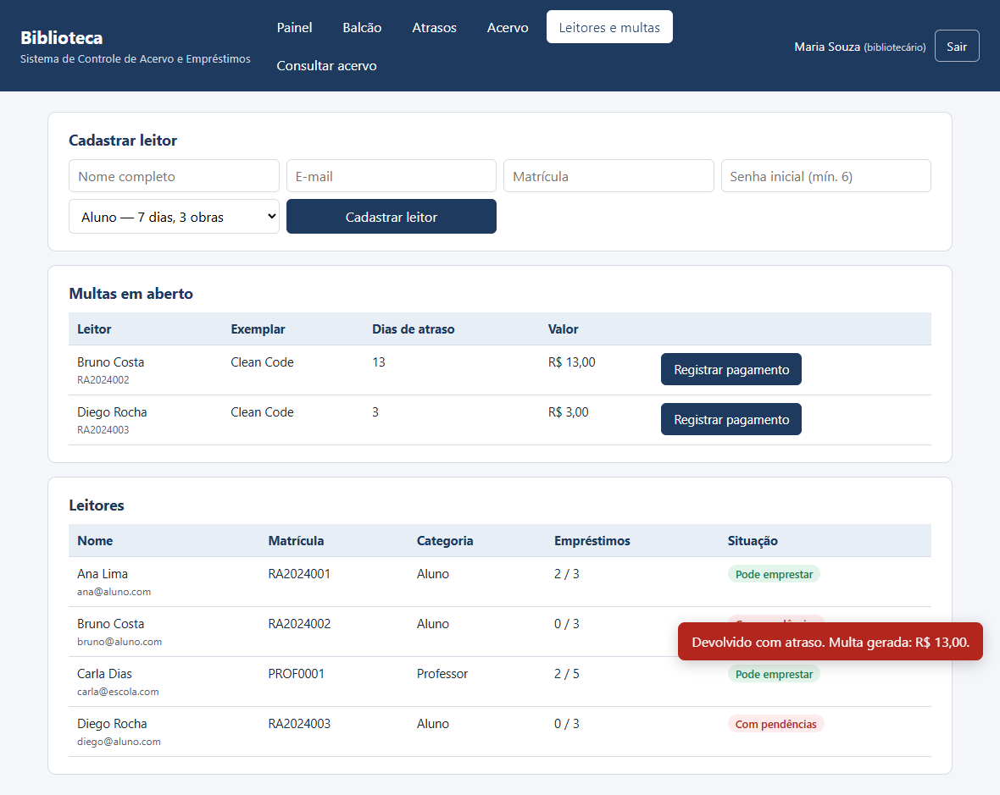
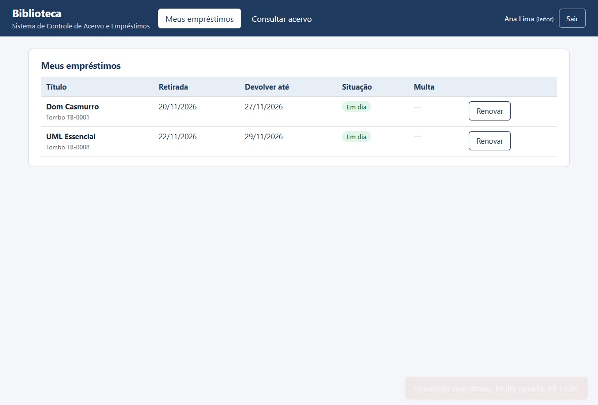

**CENTRO UNIVERSITÁRIO CAMPO LIMPO PAULISTA – UNIFACCAMP**
Projeto Interdisciplinar de Orientação a Objetos

# SISTEMA DE CONTROLE DE BIBLIOTECA
## Fase 3 — Implementação

José Francisco — RA 33759
Nicolas Beltranelo — RA 33732

Prof. Marcio Cruz · Campo Limpo Paulista · 2026

---

## 1.1 Identificação do projeto

**Nome do projeto:** Sistema de Controle de Biblioteca

**Integrantes:** José Francisco (RA 33759) e Nicolas Beltranelo (RA 33732)

**Introdução.** Uma biblioteca de pequeno porte controla acervo e empréstimos em fichas de papel ou planilha, o que causa exemplares sem rastreabilidade, atrasos não identificados, multas calculadas de cabeça e usuários que precisam ir até a biblioteca para saber se um livro está disponível (Fase 1). O sistema implementado nesta fase é a primeira versão funcional da solução proposta: registra o acervo (títulos e exemplares), os leitores e a circulação, e aplica automaticamente as regras de empréstimo — disponibilidade do exemplar, pendências do leitor, limite de obras, prazo e multa por atraso. A consulta ao acervo é pública, pelo navegador.

---

## 1.2 Linguagem e ferramentas utilizadas

| Item | Utilizado |
|---|---|
| Linguagem do backend (regras de negócio) | **Java 21** (somente o JDK, sem frameworks) |
| Linguagem da interface | **TypeScript** (compilado para JavaScript pelo `tsc`), HTML e CSS |
| Ambiente de desenvolvimento | Visual Studio Code |
| Execução | Docker Compose com **3 contêineres**: `db` (PostgreSQL 16 com volume persistente), `backend` (Java) e `frontend` (nginx servindo o TypeScript) |
| Banco de dados | **PostgreSQL 16**, acessado por JDBC |
| Bibliotecas externas | Java: apenas o driver JDBC do PostgreSQL. TypeScript: apenas o compilador `typescript` (desenvolvimento) |
| Recursos do JDK usados | `com.sun.net.httpserver` (servidor HTTP), `java.sql` (JDBC), `java.time` (datas), PBKDF2 (hash de senhas) |

Escolhas entre as alternativas analisadas na Fase 1: backend em **Java**, interface em **TypeScript** consumindo uma API REST em JSON, banco **PostgreSQL**, tudo em contêineres Docker.

---

## 1.3 Implementação das classes

O código está em `backend/src/biblioteca/`. As classes do pacote `modelo` correspondem uma a uma às do Diagrama de Classes da Fase 2.

| Classe | Principais atributos | Principais métodos | Responsabilidade |
|---|---|---|---|
| `Usuario` (abstrata) | id, nome, email, senhaHash | `autenticar(senha)`, `atualizarDados(nome, email)`, `getPerfil()` | Dados comuns de quem tem login; autenticação com senha criptografada. Não é instanciada. |
| `Leitor` (herda de Usuario) | matricula, categoria, lista de empréstimos | `possuiPendencias()`, `podeEmprestar()`, `consultarEmprestimos()` | Aluno ou professor. Sabe dizer se tem atraso/multa em aberto e se pode pegar outra obra. |
| `Bibliotecario` (herda de Usuario) | registroFuncional | `registrarEmprestimo(leitor, exemplar)`, `registrarDevolucao(emprestimo)` | Operador do balcão; único perfil que registra empréstimos e devoluções. |
| `CategoriaLeitor` | nome, prazoDias, limiteObras, valorMultaDiaria, limiteRenovacoes | getters | Guarda as regras que variam por tipo de leitor. |
| `Livro` | id, titulo, autor, editora, isbn, assunto, exemplares | `adicionarExemplar(tombo)`, `qtdDisponiveis()`, `qtdTotal()` | Representa o **título**. Compõe seus exemplares. |
| `Exemplar` | id, codigoTombo, situacao, dataBaixa, motivoBaixa | `estaDisponivel()`, `alterarSituacao(s)`, `registrarBaixa(motivo)` | Cópia física; é o objeto que de fato é emprestado. |
| `SituacaoExemplar` (enum) | DISPONIVEL, EMPRESTADO, RESERVADO, BAIXADO | — | Estados possíveis do exemplar. |
| `Emprestimo` | id, dataEmprestimo, dataPrevista, dataDevolucao, qtdRenovacoes, leitor, exemplar, bibliotecario, multa | `calcularDataPrevista()`, `renovar()`, `registrarDevolucao(data)`, `estaAtrasado()`, `diasAtraso()` | Classe central: liga quem retirou, o que foi retirado e quem registrou. Calcula prazo e atraso. |
| `Multa` | id, valor, dataGeracao, paga | `calcularValor()`, `quitar()` | Valor gerado por devolução com atraso; enquanto aberta, bloqueia novos empréstimos. |
| `Reserva` *(versão posterior)* | id, dataSolicitacao, posicaoFila, ativa | `notificar()`, `cancelar()` | Existe conforme o diagrama, mas ainda não está ligada ao sistema (RF11). |

Camadas de apoio (arquitetura da Fase 2: Controladores → Serviços → Repositórios):

| Camada | Classes | Papel |
|---|---|---|
| `repositorio` | `RepositorioMemoria<T>` (genérica), uma subclasse por entidade e `Banco` (JDBC) | Guardam os objetos em memória e gravam cada alteração no PostgreSQL; na partida recarregam tudo do banco. |
| `servico` | `AcervoServico`, `LeitorServico`, `CirculacaoServico`, `AutenticacaoServico` | Buscam os objetos e chamam os métodos do modelo; as regras ficam no modelo, não nos serviços. |
| `web` | `Roteador`, `AcervoControlador`, `LeitorControlador`, `CirculacaoControlador`, `AutenticacaoControlador` | API REST: verificam o perfil (visitante, leitor, bibliotecário) e traduzem erros de regra em códigos HTTP. |

**Conceitos de POO aplicados:** classes e objetos; atributos privados com encapsulamento; construtores com validação; **herança** (`Leitor` e `Bibliotecario` herdam de `Usuario`); **classe abstrata** (`Usuario`); **polimorfismo** (`getPerfil()`); **composição** (`Livro` cria e possui seus `Exemplar`, cujo construtor é restrito ao pacote); **associações** com multiplicidade (Leitor 1–0..* Emprestimo, Emprestimo 1–0..1 Multa); **enumeração**; **interface** (`Identificavel`, `Controlador`) e **classe genérica** (`RepositorioMemoria<T>`).

---

## 1.4 Funcionalidades implementadas

Cada funcionalidade ataca um problema levantado na Fase 1.

| Funcionalidade | Req. | Como funciona | Problema da Fase 1 que resolve |
|---|---|---|---|
| Consultar acervo e disponibilidade | RF04 | Busca por título, autor, assunto ou ISBN (sem diferenciar acentos), **sem login**; mostra "X de Y disponíveis". | Não saber quantos exemplares estão livres; consulta só presencial |
| Cadastrar livro (título) | RF01 | Formulário com campos obrigatórios; ISBN único. | Registros incompletos ou ilegíveis |
| Cadastrar exemplar | RF02 | Vincula uma cópia (código de tombo único) a um título. | Não distinguir título de cópia física |
| Cadastrar leitor | RF03 | Nome, e-mail, matrícula, senha (gravada como hash) e categoria. | Controle de quem está com cada obra |
| Registrar empréstimo | RF05, RF07, RF08 | Confere exemplar livre, leitor sem atraso/multa e limite de obras; calcula a data de devolução pela categoria. Dois balcões não emprestam o mesmo exemplar. | Empréstimo sem validação; obras sem rastreio |
| Registrar devolução | RF06, RF09 | Encerra o empréstimo, libera o exemplar e **gera a multa automaticamente** se houve atraso. | Multas calculadas de cabeça |
| Renovar empréstimo | RF06 | Soma o prazo da categoria; nega se atingiu o limite, se há atraso ou multa. Leitor renova só os seus. | Prazos controlados à mão |
| Quitar multa | RF09 | Registra o pagamento; libera o leitor. | — |
| Atrasos e painel | RF08 | Lista de atrasos calculada pela data do sistema; painel com ativos, atrasos, devoluções do dia, multas, exemplares livres/baixados. | Atrasos não identificados; falta de visão geral |
| Meus empréstimos | RF04 | O leitor vê prazos, situação e multas, só os dele. | Atrasos e consulta presencial |
| Baixa de exemplar | RF10 | Retira de circulação com motivo e data, preservando o histórico. | Obras que somem sem registro |
| Login e perfis | RNF02, RNF03 | Senhas com PBKDF2 e sal; três perfis (visitante, leitor, bibliotecário). A consulta pública nunca expõe dados de leitores (LGPD). | Acesso indevido a dados |

**Pendente (fora do escopo desta fase):** fila de reservas e aviso na devolução (RF11 — a classe `Reserva` já existe); rotina de backup do banco (RNF10); relatórios gerenciais; avisos de vencimento por e-mail; importação do acervo por planilha; exclusão/anonimização de dados do leitor (LGPD); HTTPS.

---

## 1.5 Relação entre a modelagem e a implementação

O Diagrama de Classes da Fase 2 foi seguido como contrato: cada classe, atributo, método e relacionamento do diagrama existe no código com o mesmo nome e a mesma responsabilidade.

| Elemento do diagrama | Onde está no código |
|---|---|
| Generalização `Usuario ← Leitor, Bibliotecario` | `Leitor extends Usuario`, `Bibliotecario extends Usuario` |
| Composição `Livro ◆— Exemplar` (1 para 1..*) | `Livro.adicionarExemplar()`; construtor de `Exemplar` restrito ao pacote |
| `Leitor 1 — 0..* Emprestimo` | `Leitor.emprestimos` |
| `Exemplar 1 — 0..* Emprestimo` e nota "só 1 em aberto" (RF07) | `Bibliotecario.registrarEmprestimo` exige `exemplar.estaDisponivel()` |
| `Bibliotecario 1 — 0..* Emprestimo` | `Emprestimo.bibliotecario` |
| `Emprestimo 1 — 0..1 Multa` | `Emprestimo.multa`, criada só em `registrarDevolucao` quando `diasAtraso() > 0` |
| `Leitor → CategoriaLeitor` | `Leitor.categoria`; prazo, limite e multa vêm dela |
| `Reserva` | `Reserva` (sem ligação ao sistema ainda) |

**Alterações em relação à Fase 2 e justificativas**

| Alteração | Justificativa |
|---|---|
| `atualizarDados()` recebe `nome` e `email` | O diagrama não trazia parâmetros; sem eles o método não teria o que atualizar. |
| `registrarEmprestimo`/`registrarDevolucao` ganharam versão com data | Permite carregar dados de demonstração e testar atraso sem esperar dias reais. |
| Interface `Identificavel` (getId/setId) | O repositório atribui o identificador, simulando o que o banco fará. |
| `Usuario.getPerfil()` abstrato; `Leitor.possuiMultaEmAberto()`, `qtdEmprestimosAtivos()`; `Livro.qtdTotal()`; `Emprestimo.motivoImpedimentoRenovacao()` | Métodos de apoio para mostrar ao usuário **por que** uma operação foi negada. |
| Backend em Java puro (servidor HTTP do JDK + JDBC) em vez de Spring Boot/JPA | Evitou-se configurar o framework para concentrar o tempo na orientação a objetos. Os repositórios isolam o armazenamento, então migrar para JPA depois não altera o modelo nem os serviços. |
| Persistência *write-through*: objetos em memória + gravação no PostgreSQL a cada alteração | As regras (`podeEmprestar()`, `diasAtraso()`...) operam sobre o grafo de objetos do diagrama. Foram criados métodos `restaurar(...)` no modelo para reconstruí-lo a partir do banco sem refazer validações nem o hash de senha. |
| Baixa de exemplar só se ele não estiver emprestado | Evita deixar um empréstimo aberto para sempre; a devolução é registrada antes da baixa. |

---

## 1.6 Dificuldades encontradas e soluções adotadas

> *Revisem este tópico e ajustem ao que o grupo realmente viveu; abaixo estão as dificuldades reais da construção deste código.*

| Dificuldade | Solução |
|---|---|
| **Separar título de cópia física** (dificuldade 3 da Fase 1) | `Livro` e `Exemplar` separados com composição; a disponibilidade é calculada contando exemplares `DISPONIVEL`. |
| **Impedir empréstimo duplicado com dois atendimentos simultâneos** (dificuldade 2) | Duas camadas: a validação e a gravação ocorrem num bloco sincronizado no `Roteador`, e o PostgreSQL tem um índice único parcial que proíbe dois empréstimos em aberto do mesmo exemplar. Testado com duas requisições simultâneas: uma retornou 201 e a outra 422. |
| **Reconstruir os objetos a partir do banco** | Métodos `restaurar(...)` no modelo e carga em ordem de dependência (categorias, usuários, livros, exemplares, empréstimos, multas). Testado reiniciando só o backend: painel, multas e bloqueios continuaram idênticos. |
| **Backend subir antes do banco estar pronto** | `healthcheck` no `db` com `depends_on` no compose e tentativas de reconexão no `Banco`. |
| **Onde colocar as regras** | Ficaram nas classes do modelo (ex.: `Leitor.podeEmprestar()`, `Emprestimo.diasAtraso()`); os serviços só orquestram. |
| **Testar atraso e multa sem esperar dias** | Versões dos métodos com data e carga de dados com um atraso e uma multa já existentes. |
| **Segurança das senhas** | PBKDF2 com sal aleatório; mensagem de erro idêntica para e-mail inexistente e senha errada. |
| **Segurança da interface** | Todo texto vindo do servidor é escapado antes de ir para o HTML; o servidor de arquivos impede acesso fora da pasta da interface. |
| **Sem bibliotecas externas** | Foi escrito um leitor/escritor de JSON mínimo (`Json.java`) e um roteador próprio. |

---

## 1.7 Resultados obtidos

Evidências em `docs/evidencias/`.

**Consulta pública, sem login** — busca por "programação", com disponibilidade por título

**Painel do bibliotecário**

**Empréstimo bloqueado: leitor com atraso (RF08)**

**Empréstimo bloqueado: exemplar já emprestado (RF07)**

**Empréstimo registrado, com prazo calculado (RF05)**

**Tela de atrasos**

**Devolução com atraso gera multa automática (RF09)**

**Acervo: exemplares de um título e baixa (RF02, RF10)**

**Leitores e multas em aberto**

**Área do leitor**

**Execução em console e testes automáticos:** [saida-demonstracao.txt](evidencias/saida-demonstracao.txt) e [saida-testes.txt](evidencias/saida-testes.txt) (29 verificações, 0 falhas).

---

## Síntese — materiais entregues

1. **Documentação:** este documento.
2. **Código-fonte:** pastas `backend/` (Java) e `frontend/` (TypeScript), com `README.md`, um `Dockerfile` por serviço e `docker-compose.yml`.
3. **Evidências de execução:** `docs/evidencias/`.

---

## Roteiro da apresentação (15 a 20 minutos)

| Tempo | Conteúdo | O que mostrar |
|---|---|---|
| 0–2 min | Contexto: biblioteca em papel, problemas da Fase 1 | Slide com os 8 problemas |
| 2–4 min | Linguagem e ferramentas | Java + TypeScript + PostgreSQL + os 3 contêineres; tabela 1.2 |
| 4–8 min | Classes principais | Diagrama da Fase 2 ao lado do código de `Emprestimo`, `Livro`/`Exemplar` e `Usuario` |
| 8–14 min | **Demonstração ao vivo** | Consulta pública → login → empréstimo bloqueado por atraso → bloqueado por exemplar → empréstimo válido → devolução com multa → quitar multa → área do leitor |
| 14–16 min | Dificuldades e soluções | Tópico 1.6 (concorrência e título × exemplar) |
| 16–18 min | Resultados e pendências | Tópico 1.4: o que foi feito e o que falta (reservas, banco, relatórios) |

Dica de demonstração: para voltar aos dados iniciais, `docker compose down -v` e depois `docker compose up --build` (o `-v` apaga o volume do banco).
